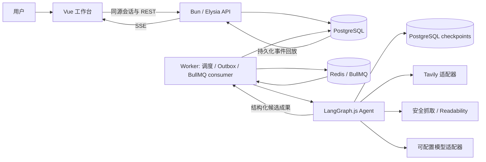
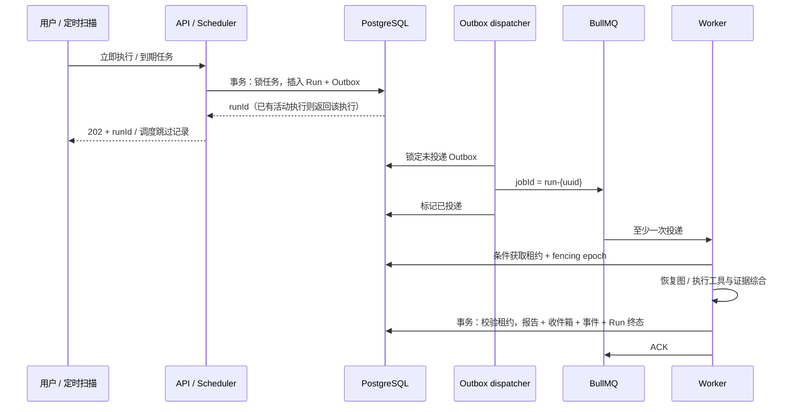
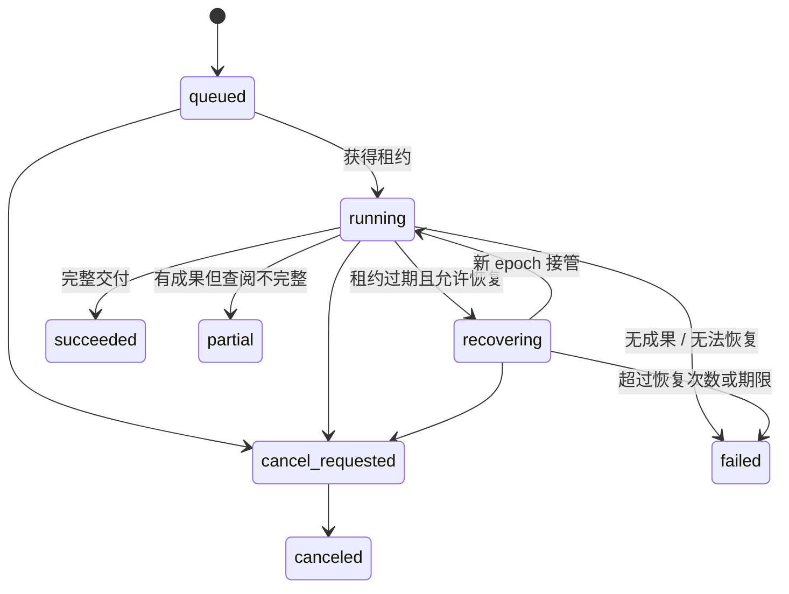

# Scova 系统架构

状态：持续演进的首版设计。已建立工作区、业务数据库、账号/任务/执行基础 API 与 Outbox 投递；Agent、交付闭环和完整界面按计划实现。下文也包含待验收的目标行为。

## 1. 产品闭环与边界

Scova（知巡）围绕长期查阅任务工作：创建目标 → 调度一次执行 → 搜索与阅读 → 整理证据 → 交付报告 → 再次执行并比较。主题可涵盖学习、教育、行业、生活与个人兴趣。

系统拥有账号、调度、权限、持久化和预算；Agent 在系统授予的工具与预算内选择检索策略、补充查证并综合证据。首版只使用 LangGraph.js 这一种持久化编排器。

API、worker 分别作为两个进程，PostgreSQL 和 Redis 是唯一首版基础服务。同机 Compose 通过反向代理提供同源网页、`/api` 和 `/api/.../events`；不引入独立调度集群、搜索集群或额外向量数据库。

## 2. 工作区与职责

| 目标目录            | 职责                                                                        | 依赖方向                                  |
| ------------------- | --------------------------------------------------------------------------- | ----------------------------------------- |
| apps/web            | Vue 3、Router、Pinia、TanStack Vue Query、UnoCSS、naive-ui；页面与 SSE 订阅 | contracts                                 |
| apps/server         | 认证、资源授权、任务版本、执行命令、报告/资料管理、事件读取                 | contracts、models                         |
| apps/worker         | 调度器、outbox dispatcher、BullMQ worker、租约、交付事务                    | contracts、models、agent-core、connectors |
| packages/contracts  | 可运行时校验的请求/响应、事件版本、枚举与错误码；不暴露 ORM 实体            | 不依赖应用                                |
| packages/models     | 业务数据模型、Prisma schema、迁移与服务端客户端                             | 不依赖应用或 contracts                    |
| packages/agent-core | LangGraph 状态图、预算策略、证据/变化规则、工具与模型接口                   | contracts；不直接使用 Elysia/BullMQ       |
| packages/connectors | Tavily、HTTP 抓取、Readability 和演示数据适配器                             | 实现 agent-core 的工具接口                |

API 不负责执行长任务，worker 不提供账号管理入口；Agent 没有通用 SQL、文件系统或任意脚本工具。`packages/models/prisma` 维护唯一业务 schema 和迁移；Server/Worker 从 `@scova/models` 引用生成模型，公开接口仍使用 `@scova/contracts`。

Server 源码分层为 `main → app → router → handler → service → repo`：app 装配 Elysia、Node 适配与生命周期，router 声明路由和中文 OpenAPI，handler 处理 HTTP/会话/响应，service 编排业务规则及事务，repo 完成数据库与 Redis 访问。utils 放纯工具。Task CAS 与 Run/事件/Outbox 仍在同一事务中完成。

Worker 使用 `main/node → app → handler → service → repo + queue`：app 管配置、资源和串行轮询，handler 接收后台批次和 Run 消息，service 编排 Outbox 投递及 Run 执行控制，repo 执行 PostgreSQL 条件写，queue 适配 BullMQ。已实现 Run 消费、续期、有限接管和取消；Agent 与报告交付仍按计划接入，默认缺执行器时明确失败。停止先阻止新领取、中断执行并等待在途批次，再依次关闭 consumer、队列、Redis 和数据库。

Outbox 每次领取的 `attempts + leaseExpiresAt` 作为本次持有凭据，领取和确认/退避均使用 CAS。过期持有者不能覆盖接管后的状态；发送成功但确认失败保留租约，到期后用同一 jobId 重投。这一边界保证至少一次传递，后续业务执行仍须幂等。

Run 另有独立租约与递增 epoch。统一 `withRunFence` 门在 Run 行锁内使用数据库当前时间校验 owner、epoch、有效期、取消和 deadline；普通进度写和受限控制终结分别处理。恢复扫描按数据库未终态事实补投 epoch 作业，并处理保留的 completed/failed job，避免仅依赖原消息。模式在创建 Run 时参与有效比较 hash，恢复保持该 hash。

所有 app/package 均以 `src` 保存源码，并配置 `@/* → ./src/*`。应用内使用别名，跨包引用包名；直接导出源码的共享包内部保留相对引用，避免消费方 TypeScript/Bun 对同名别名的解析冲突。Vite/Vitest 使用原生 tsconfig paths 解析，Node.js 启动入口由 `vpx` 处理。

M1 已将前端迁至 `apps/web`，建立 API/worker 与三个共享包的最小入口，保留 utils 有效模板测试。业务模块仍按各自 Issue 实现；新增真实测试时同步 Vitest 与 harness 覆盖声明，不将类型/常量占位验证计为业务覆盖。Bun 为主运行时，Node.js 入口通过 Elysia 官方适配器保持兼容。

依赖由 Vite+ 1.4.0 支持的 `pnpm-workspace.yaml` 管理；使用 `workspace:*` 声明包关系。`vp run <script>` 执行包脚本，`vp check` / `vp test` 使用内置工具；Bun 运行 API/worker，不能用另一份 Bun lockfile 分裂依赖来源。

## 3. 三条关键流程

### 创建任务与固定配置

1. 自然语言通过模型适配器解析为结构化草稿；未配置模型时进入清晰标识的演示/手工流程。
2. 用户编辑并确认，API 在事务中创建 Task 与 TaskVersion，校验频率、IANA 时区、预算和 URL。
3. 编辑使用 `If-Match`/revision 乐观锁；保存新版本，不覆盖旧版本。入队和运行执行固定 `taskVersionId`。
4. 计算 `comparisonScopeHash`：目标、关注/排除项、来源范围、时间窗口规则、搜索/提取算法版本和真实/演示模式参与；标题、展示形式、调度、提醒不参与。相同滚动窗口规则不因日期移动而每天重置。反馈保留独立快照，不自动清空基线。
5. 比较范围变化时下一次执行建立新基线，历史仍可查看；任务页展示“将建立新基线”。

### 调度、互斥与投递

Outbox 防止“数据库已有执行但队列丢失”。发送后宕机可能重复入队，数据库仍是事实源：已终结执行直接 ACK；同一任务的活动执行受部分唯一索引保护。BullMQ jobId 使用 UUID 前缀，不含冒号；队列去重只作优化，不替代数据库幂等。

worker 每 30 秒扫描到期任务，以 `FOR UPDATE SKIP LOCKED` 领取到期项；更新 `nextRunAt`、创建执行/跳过记录和 outbox 在同一事务内完成。默认先保持低并发，worker 全局并发 2，可通过配置调整；账号级任务数、运行次数和排队量有上限。

频率为手动/每日/每周，持久化当地时间、IANA timezone 和 UTC `nextRunAt`。采用支持显式 DST 消歧的时间库（M1 验证后锁版本），不存在的当地时刻顺延到下一有效时刻，重复时刻只选择较早一次。停机后最多补最近一次时点，更早记录为错过；活动执行时到期记为跳过，避免积压。修改计划在锁内重算 nextRunAt 并增加 scheduleRevision。

### 交付与后续对比

首次完整执行创建基线；后续执行只读取同一 task、比较范围和服务模式下最近一次完整交付。抓取证据、引用和变化先作为本次执行数据保存，最终以一个事务提交不可变报告、差异、收件箱、提醒、结束事件和执行终态；完整执行同时更新基线指针。

部分执行可以交付 `partial` 报告，但不更新基线。无可用证据/结构校验失败为 `failed`，不创建伪成果。取消与交付竞争时均锁 Run 行：先提交的决定终态，取消已成功执行返回“已经完成”。运行中的取消先写 cancel_requested，并在每次工具调用前、返回后和交付前检查。

## 4. 状态、租约与恢复

Task 生命周期：`active ↔ paused → archived`。暂停只阻止新调度，手动运行要求用户明确操作；归档禁止新执行。Run 状态：

活动状态包含 queued/running/recovering/cancel_requested。租约默认 30 秒、10 秒续约，所有业务写入必须在事务中验证 `leaseOwner + leaseEpoch + leaseExpiresAt`；每次接管递增 epoch，阻止旧 worker 继续提交。业务写入包括工具预留、证据、事件和报告，不能仅在最终交付时检查。

LangGraph checkpointer 使用 PostgreSQL，实现时在适配层验证 Bun 兼容性。每个租约 epoch 使用独立 thread/namespace。checkpoint 写完后，在受 fencing 保护的事务中提升 Run 的 `checkpointRef`；只有已提升的 checkpoint 可用于恢复。新 epoch 从这个明确引用恢复已提交图状态，不读取旧线程的“最新”指针；旧 worker 的迟到 checkpoint 无法污染新运行。恢复后节点按工具调用幂等键跳过已完成操作。该 checkpoint 提升与跨 thread 恢复协议是 M1 必须做的技术实验，未验证前不得声称具备恢复能力。

工具调用先保存唯一 operationKey（基于 run、逻辑节点与计划序号）并预留预算，再访问供应商，再保存结果。若进程在外部调用成功、落库之前崩溃，该调用为 `unknown`；恢复时不假定未计费，不释放预留预算。确需重查则创建新的调用序号并再次占用预算；允许重复外部请求，但保证业务成果和提醒不会重复。首版不宣称外部工具调用 exactly-once。

临时网络/429/5xx 最多重试 2 次（共 3 次尝试），指数退避和 jitter，遵守 Retry-After，所有尝试计入预算；配置/认证/结构错误直接终止或提示修正。基础恢复最多接管 3 次；执行 wall-clock 从首次开始计时，恢复不重置 5 分钟期限。失败后的用户“重试”创建新 Run 并记录 parentRunId，使用原版本和预算，仍需通过活动执行约束。

## 5. Agent 图、工具与模型

图节点：`load_context → plan → search → select → read → verify → compare → synthesize → validate → ready_for_delivery`。搜索/阅读/查证可以在预算内形成有限循环，图递归上限作为兜底；交付由 worker 的领域服务完成，图不能自行发送提醒或改写基线。

状态保存 run/version、owner 上下文引用、基线、反馈快照、检索计划、证据 ID、调用账本摘要、候选结论、coverage 与错误；不把整个历史网页反复塞入模型上下文。图输入只接受服务器加载的数据，禁止客户端指定 owner、checkpoint namespace 或任意工具参数。

| 接口                             | 首个实现                                    | 约束                                                        |
| -------------------------------- | ------------------------------------------- | ----------------------------------------------------------- |
| SearchProvider.search            | Tavily                                      | 返回结构化候选 URL、标题、片段；请求有超时/限额             |
| PageReader.read                  | HTTP + jsdom + Readability                  | HTML 限长 2 MiB、正文限长、每次请求最多 15 秒，保留抓取状态 |
| ModelProvider.generateStructured | 部署者配置的兼容模型服务                    | 通过适配层映射 structured output、usage、AbortSignal 与错误 |
| EvidenceRepository               | worker 注入的受限领域接口                   | 仅当前用户、当前 Run；不暴露 Prisma client                  |
| CheckpointAdapter                | LangGraph PostgreSQL saver + epoch 引用提升 | 实验验证恢复协议，运行迁移与连接池限制                      |

默认每次 10 次搜索、20 次网页读取、5 分钟，另设累计输入 40,000 token、输出 8,000 token 上限。每次模型调用先预留估算输入和最大输出 token，最终按 usage 结算；供应商不返回 usage 时使用保守预留并标为估算。提示词/结构化修复调用同样计费和计入限制。恢复/重试不得绕过限制，预算修改只影响新版本。时间预算到达后停止所有外部调用，仅允许从已存证据用确定性模板交付 partial（无证据则 failed），不得再启动模型综合；用户取消则不交付。

工具输出经过结构校验，来源内容是数据而不是指令。不展示模型隐式思维链；执行详情展示节点状态、工具类型、查询摘要、耗时、来源和用量。自然语言配置草稿也通过同一模型适配层，但与执行预算分开限流计量。

## 6. 去重、变化与完整性

URL 规范化移除 fragment、默认端口和明确跟踪参数，保留语义参数；不盲目删除全部 query。重定向和 canonical 声明经安全验证，仅作为候选关联，不自动信任跨站 canonical。正文去除导航/广告噪声后以固定提取算法版本计算 SHA-256。

| 情况                       | 标记                      | 基线/提醒行为                              |
| -------------------------- | ------------------------- | ------------------------------------------ |
| 首次完整执行               | baseline                  | 保存可比较证据，不把全部条目伪装成后续新增 |
| 相同规范 URL、同稳定正文   | duplicate                 | 不重复推荐                                 |
| 新 URL、无已知内容匹配     | new                       | 展示新增与相关性依据                       |
| 新 URL、相同/近似正文      | duplicate_candidate       | 保留来源，默认不重要提醒；可标注转载       |
| 同 URL、正文变化且事实相关 | changed                   | 保存新旧 snapshot 和事实差异               |
| 仅模板/导航变化            | duplicate 或 non_material | 可查阅原始差异，不发重要变化提醒           |
| 无法确定事实含义           | uncertain                 | 待核验，保留证据和置信说明                 |
| 本次没找到旧 URL           | 未观察到                  | 不推断被删除或事实撤回                     |

同 URL 的事实变化优先于跨 URL 指纹去重，避免新页面恰好和其他页面内容相同时漏掉截止日期变化。`ChangeRecord` 保存分类和 old/new snapshot，不删除旧证据。

完整性记录目标子问题覆盖、已执行查询、必查来源、搜索/读取失败、预算/时间耗尽和冲突未核验。模型可建议补查，最终 `complete` 判定由系统校验覆盖条件；complete 仅表示完成本次计划，不保证互联网穷尽。`no_important_change` 必须同时满足完整查阅和零已确认重要变化；`partial`/`failed` 使用独立状态，不能沿用该文案。

演示模式由执行开始时固化：缺少搜索或模型配置时使用全演示管线，并在任务、执行、报告中显示原因。mode 参与比较范围，演示基线不会与真实资料合并。已配置供应商运行中报错直接走错误/不完整流程，禁止静默回退。

## 7. API、事件与页面数据

REST 采用 `/api/v1`，标准错误包含 `code/message/requestId/fieldErrors`，列表使用游标分页；任务配置和输出结构定义在 contracts，通过运行时校验拒绝非法状态。owner 由会话推导，禁止请求体传入 userId 来选择租户。

| 资源     | 首版接口约定                                                                    |
| -------- | ------------------------------------------------------------------------------- |
| 账号     | POST /auth/register、/login、/logout；GET /me；PATCH /me/preferences            |
| 配置草稿 | POST /task-drafts（解析），失败可手工继续                                       |
| 任务     | GET/POST /tasks；GET/PATCH /tasks/:id；POST /tasks/:id/pause、resume、archive   |
| 执行     | POST /tasks/:id/runs；GET /runs/:id；POST /runs/:id/cancel、retry               |
| 事件     | GET /runs/:id/events；支持 Last-Event-ID 和 after 游标                          |
| 成果     | GET /reports、/reports/:id；GET/PATCH /inbox/:id                                |
| 知识     | GET/POST/DELETE /bookmarks；GET/POST/PATCH/DELETE /notes；POST/DELETE /feedback |
| 后续研究 | POST /reports/:id/questions；新检索显式创建关联 Run                             |

写命令携带 `Idempotency-Key`，服务端绑定 user、路由/资源、payloadHash，并保存响应引用；同 key 不同 payload 返回 409。任务编辑另用 revision 防止丢失更新。跨账号资源统一 404，集合查询同样 owner 过滤，不能只验证详情页。

RunEvent 按 `(runId, seq)` 严格递增，包含 `schemaVersion/eventId/type/occurredAt/payload`。API 首先重放数据库事件，再持续拉取更大 seq，避免切换实时流的缺口；首版直接短周期查询 PostgreSQL，Redis pub/sub 日后可作唤醒优化。SSE 每 15 秒心跳，重连按事件 ID 去重；慢客户端断开后可重连。游标越过保留范围时返回 reset 信号并加载 Run 快照，而不是永久等待。

事件类型包括 run.queued/started/recovering、step.started/completed、tool.started/completed/failed、budget.updated、coverage.updated、report.published、run.completed/failed/canceled。持久化业务事件，不把逐 token 流写入事件表；不得暴露密钥、完整网页或敏感提示词。

Vue Query 管理服务器数据与缓存；Pinia 只管理登录态摘要、布局与未保存草稿等客户端状态；避免同一任务列表同时存两份事实源。HTTP 请求统一经 requestlane 的 Fetch transport、defineEndpoint 和运行时校验，默认关闭其缓存，由 Vue Query 单独拥有服务器缓存。保留原生 HTTP 状态和标准错误体，不默认启用 sendsCodec。会话采用同源 Cookie，不能迁移成参考项目的 localStorage JWT。

requestlane 0.1.3 当前 Client 的 responseType 不包含流式类型；SSE 因此在 apps/web/src/api 的单一模块经同一个 createFetchTransport().native 读取 Response.body，并实现帧解析、Last-Event-ID、断线重连和 AbortSignal。native 入口绕过 Client 的校验、超时、session 与错误 hook，模块必须显式补齐事件 schema 校验、状态检查、idle timeout、会话 epoch、换号断开和取消处理。页面只调用 composable/service，不直接 fetch/axios；SSE 使相应 query 失效，断线时展示重连中，终态以 API 快照为准。

前端代码风格以 community 为主要参照，分层、SFC 结构和具体规则见 [前端约定](frontend-conventions.md)。

## 8. 安全、运维与验证

邮箱密码 + 服务器持久化会话，密码使用 Argon2id，随机 session token 只存 hash。Cookie HttpOnly、SameSite=Lax、生产 Secure；写操作验证 Origin/CSRF token。单机同源部署，不默认开放任意 CORS。注册/登录限流；公共演示可关闭注册。首版没有邮件找回，部署文档说明恢复账号的管理方式。

所有读写通过 owner 过滤和复合外键；worker 从 Run 反查用户与权限，不信任队列 payload 中的用户信息。抓取限制 http/https、80/443 端口和公共 IP，阻止 localhost、私网、link-local、IPv4 映射 IPv6 与云元数据地址。DNS 解析结果必须绑定实际连接，重定向每跳重验，最多 3 次；无法保证解析与连接一致时拒绝请求。尊重来源限制，不绕过登录、反爬或付费墙；下载限长、按来源限制并发。

Compose 最终包括 web 反向代理、api、worker、postgres、redis；健康检查、数据库持久卷、Redis AOF、应用无 root 运行、优雅停止和外部端口最小暴露。先运行独立迁移步骤再启动 API/worker；不让每个副本抢着迁移。Prisma 业务迁移与 LangGraph checkpoint 迁移分别记录版本。

结构化日志关联 requestId/taskId/runId/epoch，密钥脱敏；指标包含成功/不完整/失败、队列延迟、恢复次数、预算消耗、去重命中、引用校验失败。默认正文和详细工具日志保留 30 天；有报告引用的短证据片段与 snapshot 元数据保留至报告删除。基础删除流程清理收藏、笔记和账号数据；备份文件设保留窗口并验证恢复。

验证顺序：纯逻辑 Vitest → PostgreSQL/Redis 集成与故障注入 → Playwright 主流程 → opt-in 真实供应商烟测。确定性演示数据验证重复/新增/变化；真实烟测单独报告凭据、服务和费用条件。首版优先 PostgreSQL 全文检索（中文效果先实测），再根据结果决定分词或 pgvector。

相关文档：[数据模型](data-model.md)、[分期计划](../guides/delivery-plan.md)、[两次执行场景](../examples/two-run-scenarios.md)、[工程验证入口](harness.md)。
