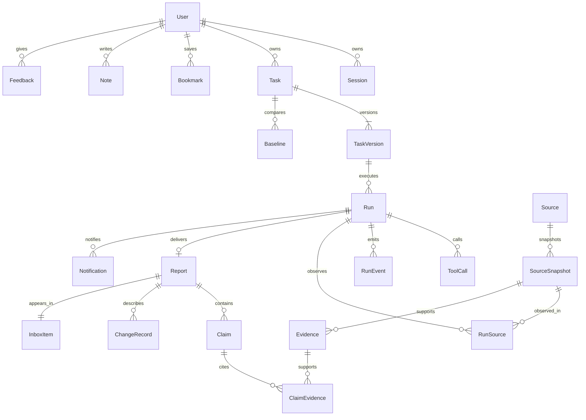

# Scova 数据模型与一致性约束

状态：待实现的逻辑模型，2026-10-24。主键使用 UUID，时间以 PostgreSQL `timestamptz` 保存；IANA timezone 单独保存。业务 schema 由 Prisma 管理，Prisma 无法表达的部分唯一索引、CHECK 与复合外键通过受版本管理的 SQL migration 补充。本文没有创建数据库或迁移文件。

## 1. 概念关系



长期任务、配置版本、执行、报告是四个实体：任务暂停不删除历史；版本保存后不可变；一个版本可执行多次；执行最多交付一个不可变报告。格式切换只是同一报告的视图，不创建四份成果。

## 2. 账号、任务与调度

下列所有用户私有实体均带 `userId`，并建立 `(userId,id)` 唯一键。外键使用 owner 复合键，防止把其他用户的合法 ID 拼接进当前用户的数据。

| 实体               | 主要字段                                                                                                             | 约束/语义                                                                                           |
| ------------------ | -------------------------------------------------------------------------------------------------------------------- | --------------------------------------------------------------------------------------------------- |
| User               | id、normalizedEmail、passwordHash、defaultTimezone、notificationPreference、createdAt                                | normalizedEmail 唯一；保留邮箱原始展示值；提醒偏好包含汇总方式和运行问题开关                        |
| Session            | id、userId、tokenHash、expiresAt、revokedAt                                                                          | tokenHash 唯一；不存明文会话 token                                                                  |
| Task               | id、userId、title、status、revision、currentVersionId、scheduleRevision、nextRunAt、createdAt、updatedAt、archivedAt | status=active/paused/archived；currentVersion 必须属于本任务与本用户                                |
| TaskVersion        | id、userId、taskId、version、inputText、configSchemaVersion、configJson、comparisonScopeHash、createdAt              | unique(userId,taskId,version)；不可变；configJson 必须经过 contracts 校验                           |
| ScheduleOccurrence | id、userId、taskId、scheduleRevision、scheduledAt、status、runId、missedCount                                        | unique(taskId,scheduleRevision,scheduledAt)；状态 created/skipped_overlap/missed/paused；runId 可空 |
| Baseline           | userId、taskId、comparisonScopeHash、completeRunId、updatedAt                                                        | unique(userId,taskId,comparisonScopeHash)；只指向同范围完整交付的 Run                               |

configJson 包括主题/目标/关注/排除/来源偏好、滚动或固定时间范围、manual/daily/weekly schedule、当地时分、weekday、timezone、outputFormat、预算、notificationPreference。用户默认时区与提醒偏好由 `PATCH /me/preferences` 保存，创建任务时复制到草稿，保存后以任务版本为准；修改用户默认值不追溯改写已有版本。重复字段仅用于索引的投影必须在保存版本的同一事务更新，禁止应用维护两份各自可写配置。

TaskVersion 的 `comparisonScopeHash` 对标准化配置的语义子集和检索/提取策略版本计算，不把 nextRunAt、展示形式或提醒偏好加入。Run 的同名字段对版本范围、mode 和比较策略版本一起计算，即含服务模式的有效比较范围，不要求与版本字段相等。执行在创建时固化 mode，首次领取固定 `baselineRunId`（也包括没有基线时的 null），恢复不重新选择。反馈快照独立保存，不原地修改配置版本。切换演示到真实执行或升级比较策略必须建立相应范围的基线。

## 3. 执行与持久化过程

| 实体              | 主要字段                                                                                                                        | 约束/语义                                                                              |
| ----------------- | ------------------------------------------------------------------------------------------------------------------------------- | -------------------------------------------------------------------------------------- |
| Run               | id、userId、taskId、taskVersionId、comparisonScopeHash、mode、trigger、occurrenceId、parentRunId、status                        | 版本复合外键保证同用户同任务；trigger=manual/scheduled/retry/followup                  |
| Run（运行控制）   | queuedAt、startedAt、deadlineAt、finishedAt、leaseOwner、leaseEpoch、leaseExpiresAt、recoveryCount、cancelRequestedAt           | 租约 epoch 从数据库递增，deadline 不因恢复重置                                         |
| Run（快照）       | baselineRunId、feedbackSnapshotJson、budgetJson、usageJson、coverageJson、outcome、failureCode、checkpointRef                   | 创建/开始时固定比较基线；outcome 与 status 分离                                        |
| ToolCall          | id、userId、runId、operationKey、tool、attemptNo、status、inputSummary、reservedBudget、usage、outputRef、startedAt、finishedAt | unique(runId,operationKey,attemptNo)；status=reserved/running/succeeded/failed/unknown |
| RunEvent          | id、userId、runId、seq、schemaVersion、type、payload、occurredAt                                                                | unique(runId,seq)；数据库锁 Run 行分配 seq，避免并发取 max+1                           |
| Outbox            | id、userId、aggregateType、aggregateId、eventType、dedupeKey、payload、availableAt、leaseExpiresAt、attempts、sentAt            | dedupeKey 唯一；业务变更同事务插入，有限重试与死信可见                                 |
| IdempotencyRecord | id、userId、scope、keyHash、payloadHash、status、responseCode、resourceId、expiresAt                                            | unique(userId,scope,keyHash)；不同 payload 同 key 返回 409                             |

Run.status 是执行控制状态，outcome 是业务结论：`baseline/important_change/new_findings/no_important_change/inconclusive`。`no_important_change` 仅允许完整交付且无重要变化；partial 必须是 inconclusive 或明确包含不完整标记的变化结果，不能展示完整查阅无变化文案。

预算预留与 ToolCall 插入在受租约保护的事务中提交；累计搜索次数、读取次数和 token 使用不可因 worker 恢复回滚。调用结果不确定时保留预算预留。已完成调用结果按 outputRef 重用，不能再执行一次却只计算一次费用。

LangGraph 自己的 checkpoint 表使用独立命名空间/迁移，不由 Prisma 重建。业务只保存 `checkpointRef={threadId,namespace,checkpointId,leaseEpoch}`；引用的提升必须验证当前租约。checkpoint 原始状态和线程 ID 不允许作为公共 API 参数。详见架构的 epoch 恢复协议。

## 4. 来源、快照、引用与差异

| 实体           | 主要字段                                                                                                                                                   | 约束/语义                                                                                                                  |
| -------------- | ---------------------------------------------------------------------------------------------------------------------------------------------------------- | -------------------------------------------------------------------------------------------------------------------------- |
| Source         | id、userId、canonicalUrl、canonicalUrlHash、firstSeenAt                                                                                                    | unique(userId,canonicalUrlHash)；hash 命中仍比较原 URL 防碰撞；首版不跨用户共享正文                                        |
| SourceSnapshot | id、userId、sourceId、contentHash、extractorVersion、title、publishedAt、textBody、textExpiresAt、metadataJson                                             | unique(userId,sourceId,extractorVersion,contentHash)；快照不可变，过期仅清理正文大字段                                     |
| RunSource      | id、userId、runId、sourceId、snapshotId、requestedUrl、fetchedUrl、observedAt、fetchStatus、errorCode、relevance                                           | unique(runId,sourceId)；抓取失败时 snapshotId 可空；本次观测时间独立于快照首次建立时间                                     |
| Evidence       | id、userId、runId、snapshotId、quote、selectorJson、quoteHash、capturedAt                                                                                  | 引用不可变；保存短原文、段落/字符位置及提取版本；关联同用户 snapshot                                                       |
| Report         | id、userId、runId、taskId、taskVersionId、baselineRunId、schemaVersion、title、summary、format、completeness、limitationsJson、comparisonJson、publishedAt | unique(userId,runId)；任务/版本与 Run 一致；不可原地重写历史报告                                                           |
| Claim          | id、userId、reportId、kind、text、confidenceLabel、order                                                                                                   | kind=fact/inference/conflict/insufficient；事实型关键结论必须有引用                                                        |
| ClaimEvidence  | userId、claimId、evidenceId、relation                                                                                                                      | unique(claimId,evidenceId)；relation=supports/contradicts；全部外键同 owner                                                |
| ChangeRecord   | id、userId、reportId、sourceId、kind、oldSnapshotId、newSnapshotId、factKey、oldValue、newValue、importance、reason、evidenceIds                           | kind=baseline/new/duplicate/duplicate_candidate/changed/non_material/uncertain；快照必须属于本用户及对应来源或显式转载来源 |

正文稳定指纹只用于内容去重，不代替来源 ID。一个 Source 可对应多个快照，同一个快照可以被多次执行观测。相同规范 URL 先比较自己上一版本的事实，再判断是否与其他页面重复。跨 URL 转载保留独立 Source 和可解释匹配，不把不同机构的相似招生通知合并成一条事实。

`Report.comparisonJson` 保存版本化事实清单：本次 Run、有效范围与模式、各来源的规范 URL/正文指纹/提取版本，以及带逐字引用的事实键和值。它不复制完整正文；对应引用证据随报告保留。历史缺少可授权事实清单时保留比较缺口，不由空数据推导“无重要变化”。

最终交付校验：每条 Claim 的引用必须来自本执行证据或明确引用的基线证据；引用不能是另一用户的数据。changed 必须有 old/new 证据；new 不能伪造旧值。证据不足时降级为 inference/insufficient，不通过生成一个 URL 充当引用。

全文搜索先索引 SourceSnapshot 的标题/正文与 Note 内容。PostgreSQL FTS 起步用 `simple` 配置并实测中文召回；达不到目标时优先评估分词/子串检索补充，向量检索以实际评估结果再决定。

## 5. 交付、反馈与知识沉淀

| 实体           | 主要字段                                                                           | 约束/语义                                                                             |
| -------------- | ---------------------------------------------------------------------------------- | ------------------------------------------------------------------------------------- |
| InboxItem      | id、userId、reportId、readAt、createdAt                                            | unique(userId,reportId)；每份报告都有收件箱项，是否提醒另行判断                       |
| Notification   | id、userId、runId、reportId、kind、readAt、createdAt                               | unique(userId,runId,kind)；kind=summary/important_change/run_issue；失败可无 reportId |
| Feedback       | id、userId、taskId、sourceId 或 claimId、kind、active、updatedAt                   | CHECK 恰有一种目标；唯一目标反馈键，切换反馈为更新；kind=irrelevant/known/deeper      |
| Bookmark       | id、userId、sourceId、createdAt                                                    | unique(userId,sourceId)；收藏指向来源，详情可选快照                                   |
| Note           | id、userId、sourceId 或 reportId、body、revision、createdAt、updatedAt             | CHECK 恰有一种目标；纯文本，乐观锁编辑                                                |
| ReportQuestion | id、userId、reportId、question、answerJson、evidenceRefs、followupRunId、createdAt | 仅检索当前用户已授权证据；新查阅显式关联执行                                          |

Feedback 的条件唯一索引分别覆盖 sourceId 与 claimId，避免 NULL 导致重复；跨任务 claim 反馈须验证 claim 所属报告的 taskId，资料须有本任务的 RunSource 关系。设置、切换与撤销先持有同一 Task 锁，和新 Run 创建串行决定快照。`Run.feedbackSnapshotJson` 包含结构版本、owner/task、反馈及目标的复制信息，空快照同样冻结；恢复不重捕获。资料的“已了解”指纹取标记时间之前最后一次观测，后续新值不会被自动视为已了解。

`Report.feedbackEffectsJson` 仅保存本次经工具账本与冻结快照验证的作用解释，公开为 `feedbackEffects`；撤销不更改旧报告。它不替代事实比较、证据引用或覆盖限制。问答中的事实同样要求引用。

报告和 InboxItem 在同一事务中提交。Notification 按偏好生成：summary 对每次有成果交付提醒；important_change 仅已确认重要变化；run_issue 独立展示失败/不完整，按运行问题偏好控制。站内提醒不发送外部消息，重放交付不插入第二条。

## 6. 必须落实的数据库约束

以下 SQL 为迁移设计示意，物理表名按 Prisma `@@map` 固定为 snake_case。字段命名以最终 migration 为准，不能把本文当作已执行迁移。

```sql
-- 同一任务最多一个未终结执行，包括排队与等待取消。
CREATE UNIQUE INDEX run_one_active_per_task
ON runs(task_id)
WHERE status IN ('queued', 'running', 'recovering', 'cancel_requested');

CREATE UNIQUE INDEX schedule_slot_once
ON schedule_occurrences(task_id, schedule_revision, scheduled_at);

CREATE UNIQUE INDEX report_once_per_run ON reports(user_id, run_id);
CREATE UNIQUE INDEX event_sequence_once ON run_events(run_id, seq);
CREATE UNIQUE INDEX delivery_once ON notifications(user_id, run_id, kind);

-- 不允许用户自己的 Run 连接另一个任务或账号的版本。
ALTER TABLE task_versions ADD CONSTRAINT version_owner_identity
UNIQUE (user_id, task_id, id);
ALTER TABLE runs ADD CONSTRAINT run_version_owner
FOREIGN KEY (user_id, task_id, task_version_id)
REFERENCES task_versions(user_id, task_id, id);

-- current_version_id 初始可空，在创建任务的同一事务内设置。
ALTER TABLE tasks ADD CONSTRAINT task_current_version_owner
FOREIGN KEY (user_id, id, current_version_id)
REFERENCES task_versions(user_id, task_id, id);

-- 基线只能指向同任务、同范围的执行，且 complete 状态由事务校验。
ALTER TABLE runs ADD CONSTRAINT run_scope_identity
UNIQUE (user_id, task_id, comparison_scope_hash, id);
ALTER TABLE baselines ADD CONSTRAINT baseline_scope_owner
FOREIGN KEY (user_id, task_id, comparison_scope_hash, complete_run_id)
REFERENCES runs(user_id, task_id, comparison_scope_hash, id);
```

仅 CHECK 无法跨表验证“引用来自该用户且属于合法执行”，要结合复合外键与受控事务。complete baseline 的条件由交付事务锁定并校验；不依赖不合法的跨表 CHECK。snapshot 和证据同 owner 的复合外键必须完整实现，不能只靠界面隐藏。

推荐索引：tasks(userId,status,updatedAt)、tasks(nextRunAt) WHERE active、runs(userId,taskId,queuedAt DESC)、runs(status,leaseExpiresAt)、run_events(runId,seq)、outbox(sentAt,availableAt)、reports(userId,publishedAt DESC)、inbox(userId,readAt,createdAt)。按实际 EXPLAIN 结果调整，避免为 JSON 所有字段预建索引。

## 7. 事务清单与删除规则

| 事务          | 原子变更                                                                                            | 外部副作用         |
| ------------- | --------------------------------------------------------------------------------------------------- | ------------------ |
| 创建/编辑任务 | Task + 新 TaskVersion + scheduleRevision/nextRunAt                                                  | 无                 |
| 请求执行      | 锁 Task、幂等记录、Run、Occurrence（如有）、Outbox                                                  | 提交后投递队列     |
| 工具预留      | 校验租约、ToolCall、累计预算、必要事件                                                              | 提交后调用供应商   |
| 工具完成      | 校验租约、快照/观测/证据、ToolCall 结果、事件                                                       | 无                 |
| 最终交付      | 锁 Run、校验租约和取消、Report/Claim/Change、Inbox、Notification、终态事件、Run 终态、可选 Baseline | 无外部通知         |
| 取消          | 锁 Run、cancel_requested/终态判断、事件                                                             | 提交后尽力中断工具 |

任何 SQL 事务期间不等待模型或网络请求。并发唯一冲突转为幂等返回或明确 409，不吞掉错误重试整个外部工具调用。

首版任务采用归档，保留证据和历史报告；资料/报告的硬删除必须同步移除依赖和失效的基线指针，下一次重新建基线。账号删除先暂停并取消执行，撤销会话，再受控级联清理；checkpoint/outbox/事件一并清除，不能遗漏 Agent 状态。运行中的 worker 最终写入需重新验证账号仍存在且可运行。

正文与详细工具日志默认 30 天后清理；报告引用片段、指纹和元数据随报告保留，避免全文过期后历史引用不可解释。清理不得删除仍被有效基线比较所需的事实快照摘要。备份保留窗口由部署设置明确，删除并不即时清除既有离线备份。

相关文档：[架构](architecture.md)、[交付计划](../guides/delivery-plan.md)、[验收场景](../examples/two-run-scenarios.md)。
